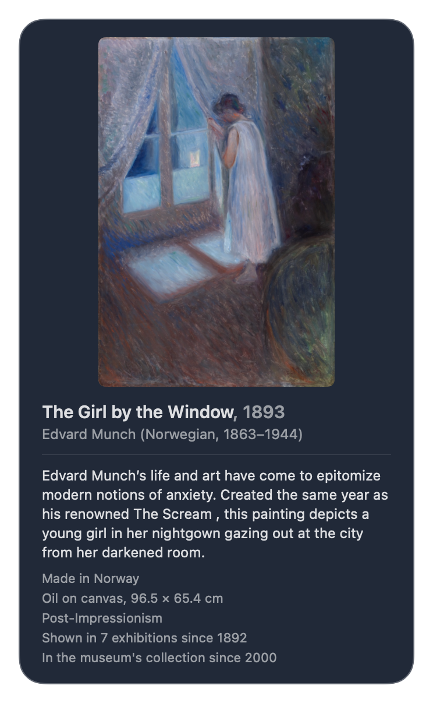

# art-widget

A daily painting from the Art Institute of Chicago, with notes from the museum. On macOS, the card sits on your desktop. The iPhone version puts the same painting on your Home Screen.



## Install on macOS

Requires macOS 26 or later and Apple's Command Line Tools. If you haven't installed the tools, run `xcode-select --install` and finish the prompt first.

```sh
git clone --branch v1.0.0 --depth 1 https://github.com/Yahlawat/art-widget.git && ./art-widget/install.sh
```

This builds the app, installs it in `~/Applications`, and starts it at login. Keep the cloned folder to run `./art-widget/uninstall.sh` later. Your painting history and cache are kept when you uninstall.

## Using it

- Drag the card anywhere. It remembers where you put it.
- Hover and click the ↗ button in the top-left corner to open the painting on artic.edu. Clicking the painting itself does nothing.
- Shows just the painting by default. Hover and click the ⌄ at the bottom of the painting to drop down the info; it remembers which way you left it.
- Hover for the ← → buttons in the top-right corner. → goes forward through paintings you went back from, then fetches a new one; ← goes back to earlier ones (last 100 kept).
- Hover and drag the ⤡ grip in the bottom-right corner to resize. The whole card zooms (painting, text, spacing) from 0.6× to 2×, and the size is remembered.
- Right-click: Next artwork, Previous artwork, Show/Hide info, Open on artic.edu, Reset size, Reset position, Quit.

## How it works

- Pool: public-domain paintings with images (`is_public_domain`, `artwork_type_title = Painting`), about 1,900 works, sorted by id.
- The day's painting comes from the date (`DailyPick.swift`), so the Mac and iPhone show the same one and it doesn't repeat until the whole pool has been shown. → past the newest painting is a random extra on the Mac.
- The API refuses positions past 1,000, so the far end of the pool is read in reverse order.
- Text comes straight from the API record: `short_description` (or the start of `description`), place, medium, size, style, exhibition count, year acquired.
- Checks for a new day on launch, on wake, at midnight, and every 15 minutes. If the API is down it keeps showing the cached painting and retries.
- State, history and cached images (`images/<id>.jpg`, oldest dropped past 100): `~/Library/Application Support/ArtWidget/`. Errors: `~/Library/Logs/ArtWidget.log`.

## Files

| File | What |
| --- | --- |
| `AICClient.swift` | API search and IIIF image fetch. Swap this to use another museum. Shared with iOS. |
| `DailyPick.swift` | Date → painting. Shared with iOS. |
| `ArtStore.swift` | Daily painting, back/next history, disk cache |
| `Facts.swift` | Record → wall-label text. Shared with iOS. |
| `ArtCardView.swift` | The card (SwiftUI) |
| `DesktopPanel.swift` | Desktop-level window, position memory |
| `main.swift` | App setup, timers, `--snapshot` |

## iPhone

A Home Screen widget in `ios/`, medium or large: the same daily painting, ← → buttons, and a tap opens the museum's notes in the app. Pick the size by swiping in the widget gallery. Requires Xcode, [XcodeGen](https://github.com/yonaskolb/XcodeGen), and iOS 18 or later. Install XcodeGen with `brew install xcodegen` if you use Homebrew.

```
cd art-widget/ios
xcodegen generate
open ArtWidgetPhone.xcodeproj
```

In Xcode, pick your Personal Team under Signing for both targets, choose your iPhone, and press Run. With a free Apple ID the app stops launching after 7 days, so plug in and press Run again to renew it.

← and → walk the same day-by-day order, so ← is yesterday's painting. They go back to today at midnight.

## Develop

Run `swift build` from the repo root, or run `./install.sh --build-only` to assemble and validate the app bundle and login agent in `.build/`.

`ART_WIDGET_DIR` overrides the state directory and `ART_WIDGET_API` overrides the API base URL for development.

## License and artwork

Art Widget's source is available under the [MIT License](LICENSE). Artwork images come from the Art Institute of Chicago's [open access collection](https://www.artic.edu/open-access/open-access-images). The app fetches images marked public domain and links to the museum's record. The preview shows [The Girl by the Window](https://www.artic.edu/artworks/154235) by Edvard Munch.
